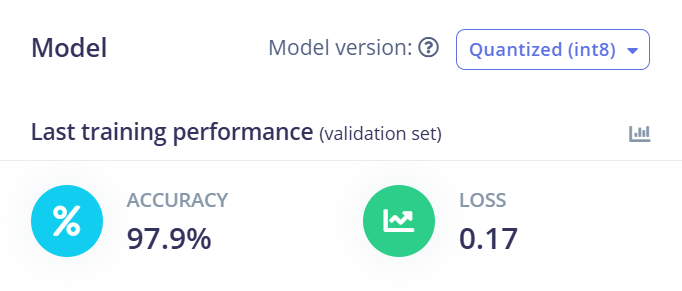
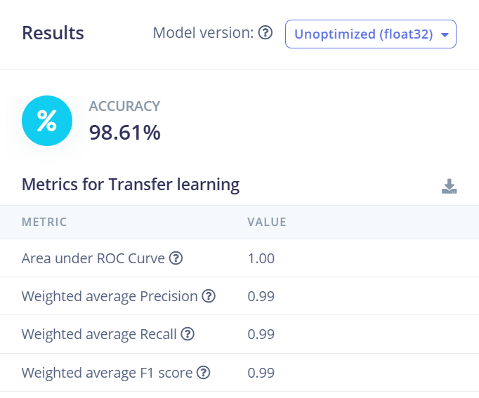

# ASL Alphabet Sign Language Detector (Edge Impulse)

A deep learning image classification workflow built in **Edge Impulse Studio** using MobileNetV2 transfer learning to recognize all **26 letters (A–Z)** of the American Sign Language (ASL) alphabet.

## Dataset Overview

* **Source:** Kaggle ASL Alphabet Hand-Gesture Dataset
* **Classes:** **26 ASL Letters (A–Z)** across multiple subjects and hand variations
* **Data Split:**
  * **Training Set:** `80%` (with data augmentation enabled)
  * **Testing Set:** `20%` (strictly held-out unseen samples)

## Impulse Architecture

1. **Image Data (`160x160` RGB):** Resizes raw hand-gesture photos into standardized `160x160` color inputs.
2. **Image Processing Block:** Extracts `27,648` normalized RGB pixel features per image.
3. **Transfer Learning (`MobileNetV2 160x160 1.0`):** Uses the full-capacity MobileNetV2 backbone with `0.1` dropout and a 26-class softmax output layer (trained for 40 epochs at a `0.0005` learning rate).
4. **Model Testing & Deployment:** Evaluates unseen test samples with ROC AUC, precision, recall, and F1-score metrics, and deploys via Edge Impulse WebAssembly / live browser client.

## Model Optimization & Results

| Iteration | Architecture & Settings | Epochs | Validation Accuracy | Validation Loss | Key Finding |
| :--- | :--- | :---: | :---: | :---: | :--- |
| **1. Baseline** | `MobileNetV2 96x96 0.35` (16-neuron dense layer) | 20 | 72.6% | 0.85 | Underfitting; low precision/recall on similar hand shapes (A, C, F). |
| **2. Increased Cycles** | `MobileNetV2 96x96 0.35` (16-neuron dense layer) | 40 | 73.6% | 1.53 | Rising loss indicated overfitting due to the 16-neuron bottleneck. |
| **3. Widened Bottleneck** | `MobileNetV2 96x96 0.35` (32-neuron dense layer) | 30 | 70.9% | 1.06 | Lowered loss, but the `0.35` width multiplier lacked capacity for 26 classes. |
| **4. Full-Capacity Backbone (Final)** | `MobileNetV2 160x160 1.0` (no dense bottleneck, 0.1 dropout) | 40 | **97.9%** | **0.17** | Removing the bottleneck and upgrading to the `1.0` backbone resolved feature confusion. |

## Final Evaluation on Unseen Test Data

* **98.61% Test Accuracy** on held-out unseen test images (`Unoptimized float32`):
  * **Area Under ROC Curve (AUC):** `1.00`
  * **Weighted Average Precision:** `0.99`
  * **Weighted Average Recall:** `0.99`
  * **Weighted Average F1-Score:** `0.99`

## How to View & Test Live

1. Open the public project directly in [Edge Impulse Studio](https://edgeimpulse.com).
2. Click **Clone this project** to inspect the Impulse design, confusion matrix, and training settings in your own account.
3. Navigate to **Deployment -> Launch in browser** (or **Live classification**) to test predictions on static hand-sign images.

> **NOTE:** Built for educational exploration and machine learning portfolio development. Optimized for cropped, clean-background hand images; wide-angle live webcam usage is sensitive to background clutter and lighting variations.
